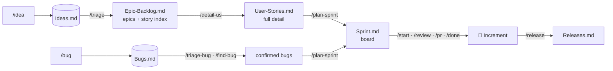
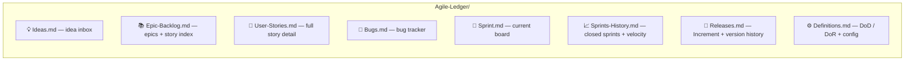

<!-- Cover: docs/assets/cover.png  (generated with Higgsfield — see docs/assets/ASSETS.md) -->
<p align="center">
  
</p>

<h1 align="center">Agile-Ledger</h1>

<p align="center">
  <strong>Plain-Markdown Scrum &amp; Agile product management for Claude Code.</strong><br>
  Run the whole product lifecycle — ideas → backlog → sprint → release, plus bug tracking — from slash
  commands. No Jira. No database. Just Markdown your whole team can read.
</p>

<p align="center">
  
  
  
  
  
</p>

---

## Why Agile-Ledger

Distributed teams on different schedules don't need another web app to log into — they need a single,
readable source of truth that lives **next to the code**. Agile-Ledger keeps your entire product
management layer as plain Markdown inside the repo: a backlog of epics and user stories, sprints with
velocity, a bug tracker, releases, and a roadmap. **GitHub holds the code; Agile-Ledger holds the
"why", joined by the user-story ID** through every branch, commit, and PR.

- **Nothing to host, nothing to sync.** It's text in your repo — diff it, review it, branch it.
- **Readable on anyone's clock.** The board, roadmap, and per-developer views are plain-text snapshots,
  perfect for async teams across time zones.
- **Clickable in preview.** Every ID is a stable anchor link, so you navigate the backlog by clicking —
  index → story → epic → dependency — in GitHub or VS Code preview.
- **Honest by design.** Nothing is auto-registered as truth, nothing is deleted, and reconstructed-from-git
  work is always flagged for human confirmation.

---

## The flow

<p align="center">
  
</p>

<details>
<summary>Mermaid source (editable)</summary>


</details>

## The eight files it manages

<p align="center">
  
</p>

<details>
<summary>Mermaid source (editable)</summary>


</details>

Each entry's heading is its **bare ID** (`#### US-014`), which gives it a stable `#us-014` anchor that
survives title changes — the backbone of the clickable navigation. Configure language, story-point
scale, your name, and whether the skill may run `git` in `Definitions.md`.

---

## Commands at a glance

<div align="center">
<table>
<tr>
<td align="center" width="14.2%"><br><sub><b>🟢 Capture</b></sub></td>
<td align="center" width="14.2%"><br><sub><b>🟢 Triage</b></sub></td>
<td align="center" width="14.2%"><br><sub><b>🔵 Backlog</b></sub></td>
<td align="center" width="14.2%"><br><sub><b>🟠 Sprint</b></sub></td>
<td align="center" width="14.2%"><br><sub><b>🟣 Inspect</b></sub></td>
<td align="center" width="14.2%"><br><sub><b>🔴 Release</b></sub></td>
<td align="center" width="14.2%"><br><sub><b>⚫ Workspace</b></sub></td>
</tr>
</table>
</div>

| Group | Commands |
|---|---|
| 🟢 **Capture** | `/idea` · `/bug` |
| 🟢 **Triage** | `/triage` · `/triage-bug` |
| 🔵 **Shape the backlog** | `/detail-us` · `/detail-epic` · `/create-task` · `/find-bug` · `/refine` |
| 🟠 **Plan &amp; run the sprint** | `/plan-sprint` · `/start-us` · `/start-bug` · `/review` · `/pr` · `/done-us` · `/done-bug` · `/close-sprint` |
| 🟣 **Inspect** (read-only) | `/board` (`/standup`) · `/my-work` · `/status` · `/roadmap` · `/guide` · `/ledger-check` · `/sync-main` |
| 🔴 **Release** | `/release` · `/changelog` |
| ⚫ **Workspace** (optional) | `/init-workspace` · `/discover-repos` · `/bootstrap-repo` · `/workspace-sync` · `/workspace-status` |

Run **`/guide`** in any session for the command-to-file map and a one-glance state summary. The full
reference lives in [`plugins/agile-ledger/README.md`](plugins/agile-ledger/README.md), and a printable
one-page cheat sheet ships as `Agile-Ledger-cheatsheet.pdf`.

---

## Quick start

```
/idea add Google sign-in to speed up onboarding
/triage                         # → epic + a few suggested Draft stories
/detail-us US-014               # → full story in User-Stories.md, linked from the epic
/bug Safari login button does nothing
/triage-bug   →   /find-bug BUG-003
/plan-sprint                    # pulls Ready stories + high-priority bugs within velocity
/start-us US-014  →  /review US-014  →  /pr US-014  →  /done-us US-014
/close-sprint   →   /release
```

## Install

First register the marketplace (once per machine), then install at the scope you want:

```
/plugin marketplace add nunoamorim99/agile-ledger
```

> Two different names are in play here, and mixing them up is the usual cause of a failed install:
> `nunoamorim99/agile-ledger` is the **GitHub `owner/repo`**, while `@nunoamorim99` is the **marketplace
> name** — the `name` field in `.claude-plugin/marketplace.json`. The install format is always
> `<plugin-name>@<marketplace-name>`, i.e. `agile-ledger@nunoamorim99`. The marketplace name here is the
> author handle so every skill installs as `<skill>@nunoamorim99`.

### Scopes

| Scope | Who gets it | How |
|---|---|---|
| **User** (default) | just you, all your projects | `claude plugin install agile-ledger@nunoamorim99 --scope user` |
| **Project** | every collaborator on this repo | commit a `.claude/settings.json` (below) |
| **Local** | just you, this repo only (gitignored) | `claude plugin install agile-ledger@nunoamorim99 --scope local` |

Or run `/plugin` → **Discover** → select **agile-ledger** → choose a scope in the UI.

### Project scope — the whole team gets it

Project scope is not really an "install" — it's a file you commit. Add this to the repository your team
works in (create `.claude/settings.json` if it doesn't exist; **merge** these keys if it does):

```json
{
  "extraKnownMarketplaces": {
    "nunoamorim99": {
      "source": { "source": "github", "repo": "nunoamorim99/agile-ledger" }
    }
  },
  "enabledPlugins": {
    "agile-ledger@nunoamorim99": true
  }
}
```

`extraKnownMarketplaces` makes the marketplace known to everyone in the repo; `enabledPlugins` turns the
plugin on. When a teammate opens the folder and trusts it, Claude Code prompts them to install the
marketplace and enable the plugin — no manual setup, and updates are a normal pull request.

> A copy of this file ships at [`install/project.settings.json`](install/project.settings.json) — drop it
> into your project's `.claude/` folder. Note: the two keys must be declared **together** at project
> scope. Trying `--scope project` interactively while the marketplace is only known at user scope is a
> common cause of a project-scope install error; committing both keys avoids it. Teammates are prompted
> to install/trust (plugins run code, so this confirmation is by design and can't be fully silent yet).

### Other ways

Every download below is on the **[latest release](https://github.com/nunoamorim99/agile-ledger/releases/latest)** page — you don't need to clone the repo or hunt for folders.

| You want | Download | Then |
|---|---|---|
| Claude Code without a marketplace (offline, corporate policy, or just to read the files first) | `agile-ledger-<version>.zip` | Unzip into your project's `.claude/` folder — or `~/.claude/` for every project. Restart Claude Code. |
| Claude.ai **web or desktop** | `agile-ledger-skill-<version>.zip` | Upload via *Customize → Skills*. |

- **One session, no install:** `claude --plugin-dir ./plugins/agile-ledger`

> Slash commands are a Claude Code feature. On Claude.ai web/desktop the skill still works, driven by
> natural language ("add a story for…", "plan the next sprint") rather than `/agile-ledger:…`.
>
> Manual installs don't auto-update — grab the newer zip when a release ships. The marketplace path
> updates itself, which is why it's the recommended one.

Installed via marketplace, commands are namespaced (`/agile-ledger:idea`). After installing, restart
Claude Code (or `/reload-plugins`) so the skills load.

---

## How it stays honest (design principles)

- **Never delete.** Discarded ideas, paused stories, and won't-fix bugs are kept with their reason.
- **State = physical position.** An item's state is where it sits; it moves only via a command, never by
  a stray edit.
- **Bookkeeping is the job; execution is opt-in.** The skill writes the ledger and *offers* git; it runs
  `git` only when you turn it on, and never pushes, merges, or opens PRs on its own.
- **Reconstructed ≠ truth.** When the workspace orchestrator infers work from git history, it proposes
  it as flagged drafts for you to confirm — it never registers guesses as fact.
- **Read in preview, change via commands.** The Markdown is for reading and navigating; all mutations go
  through the commands so the ledger stays consistent.

## Traceability

The **user-story ID is the join key** between the ledger and GitHub:

| Artifact | Shape |
|---|---|
| Branch | `us-014-google-sso` · `bug-014-safari-login` |
| Commit | `feat(auth): add Google SSO sign-in (US-014)` · `fix(auth): … (BUG-014)` |
| PR title | `Google SSO sign-in [US-014]` |

`/sync-main` reconciles `main` against the ledger and surfaces anything that merged without an ID —
the off-plan work you'd otherwise miss.

## Optional: the Workspace orchestrator

Install once at a workspace root to manage many repos: `/discover-repos` finds new repositories locally
and on your GitHub org, `/bootstrap-repo` onboards each one, and `/workspace-sync` runs a single
cross-repo "what changed while I was away" pass. It **never replaces** a repo's own `Agile-Ledger/` —
each repo stays its own source of truth — and it only discovers, syncs, and *proposes*.

---

## Repository layout

```
agile-ledger/
├── .claude-plugin/marketplace.json      # marketplace catalog
├── plugins/agile-ledger/                # ← the plugin: single source of truth
│   ├── .claude-plugin/plugin.json       # plugin manifest
│   ├── commands/                        # 31 slash commands (+ /standup alias)
│   └── skills/
│       ├── agile-ledger/                # core skill — SKILL.md + references/ (8 templates)
│       └── agile-ledger-workspace/      # optional multi-repo orchestrator
├── scripts/build_bundles.py             # builds the release zips from the plugin
├── install/                             # project-scope settings.json for teams
├── docs/assets/                         # README images (cover, group banners)
├── Agile-Ledger-cheatsheet.pdf
├── Agile-Ledger-skill-spec.md           # full design rationale
├── README.md
└── LICENSE
```

Everything ships from `plugins/agile-ledger/`. The marketplace serves it directly, and the downloadable
zips on the [releases page](https://github.com/nunoamorim99/agile-ledger/releases/latest) are built from
it on each tag — so there is only ever one copy to edit. See [CONTRIBUTING.md](CONTRIBUTING.md).

## License

MIT — see [`LICENSE`](LICENSE).

<p align="center"><sub>Built as a Claude Code skill · plain Markdown · no database · no lock-in</sub></p>
